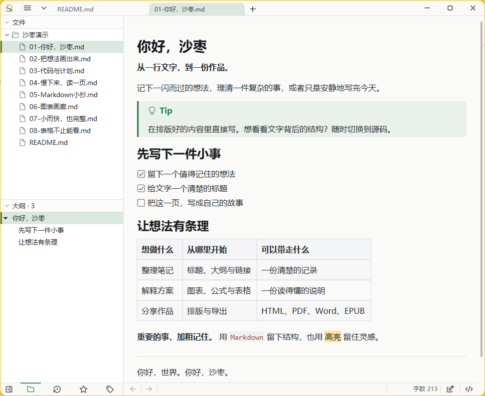
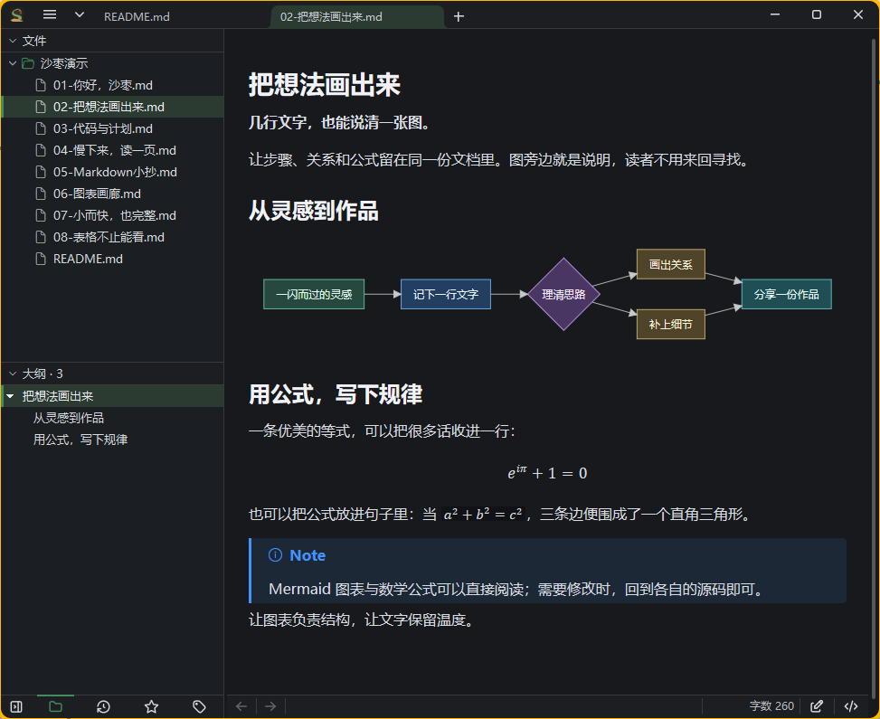
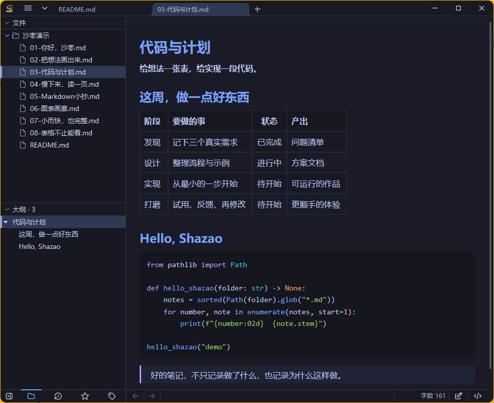
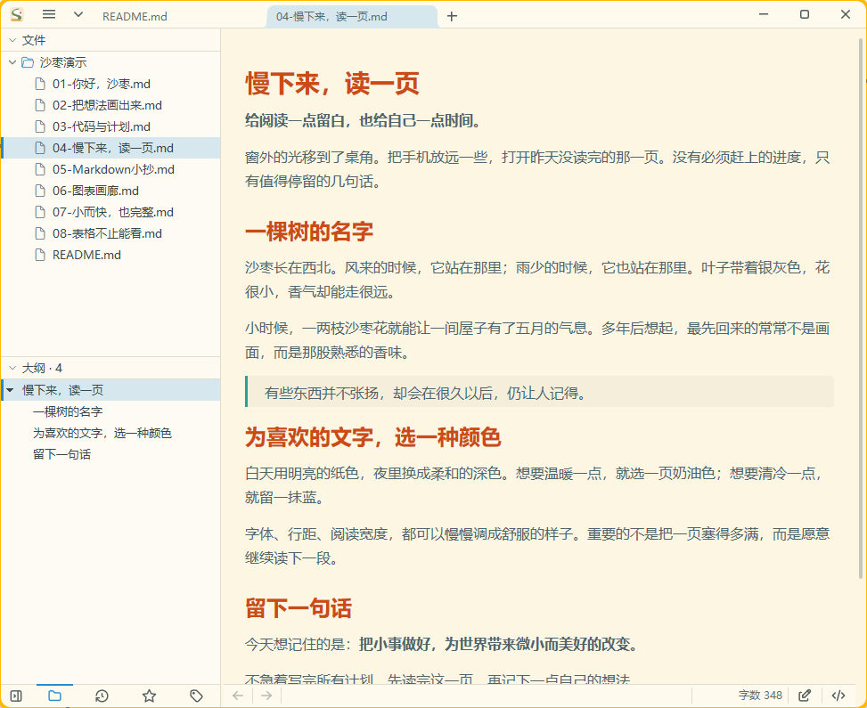
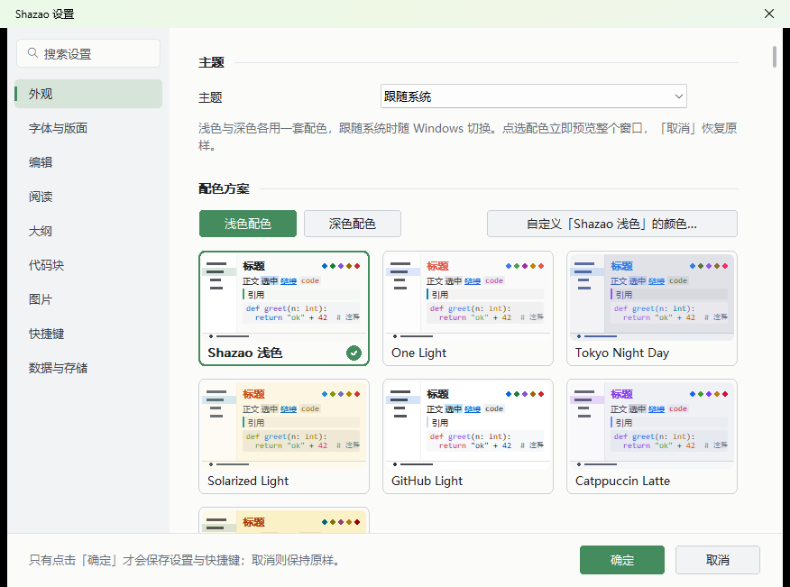
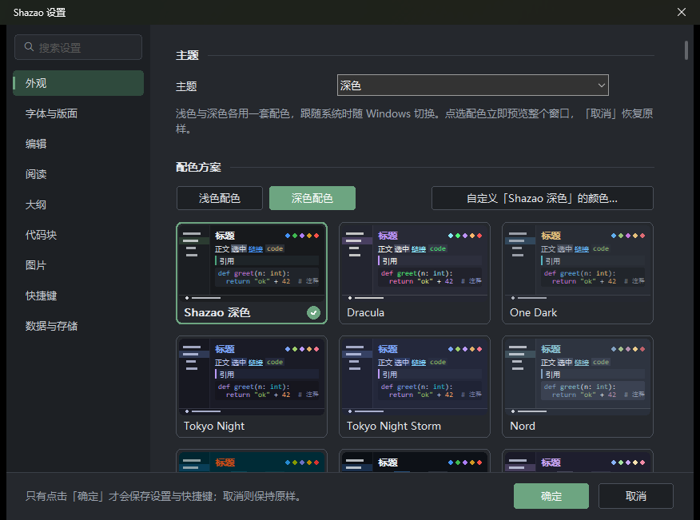

# Shazao（沙枣）

[简体中文](README.md) | [**English**](README.en.md)

A Markdown reader and editor.

**From a line of text to something worth sharing.**

Shazao（沙枣） is a lightweight, native Markdown reader and editor for 64-bit Windows 10 and 11. It is built with C++20, Win32, DirectWrite, Direct2D, and WIC, and runs independently of Electron and WebView2.

**Highlights**

**Fast opening · WYSIWYG editing · Rich diagram editing**

**Single EXE · No installation or account required · Works offline · Free**


Notes:

- Shazao is not open source for now.
- It goes online only to fetch web images and to check for updates.
- A Mac version is planned.


## Download and run

<a href="https://apps.microsoft.com/detail/9ntw7mf81l2x"></a>

To install the Store version with WinGet, run this command in Windows Terminal.

```powershell
winget install 9NTW7MF81L2X
```

- [Download the latest stable release](https://github.com/yakoye/Shazao-markdown/releases/latest): run the EXE directly, or download and extract the win64 ZIP, which includes release notes and third-party notices (and a UPX-compressed copy about 40% of the size, with the same features). Requires 64-bit Windows 10 or 11.
- History, drafts, recovery copies, image cache, persistent undo, and reading state are stored in `%LOCALAPPDATA%\Shazao` by default and can be managed under Data and Storage in Settings. INI files, shortcuts, and the user dictionary remain editable. Legacy folders such as `Shazao-history` remain readable and are not automatically deleted during upgrades.
- To carry the app and its data together, for example on a USB drive, create a `Shazao-data` folder next to the EXE; all data is then kept there (portable mode).
- New versions can be downloaded from Help ▸ Check for updates…, and are verified against the published SHA256SUMS. You can also choose a weekly check in Settings (off by default).
- See the [changelog](doc/CHANGELOG.md) for changes and [GitHub Releases](https://github.com/yakoye/Shazao-markdown/releases) for previous downloads.

## Main features

Shazao combines a lightweight Windows app with tools for reading, writing, and organizing Markdown.

- **Quick notes and command palette** · Enable quick notes in Settings to capture and organize ideas as cards. Press Ctrl+Shift+P to find and run menu commands.
- **Portable and offline** · Run a single EXE without an installer or account. Turn on offline mode or create `Shazao-data` next to the EXE to keep the app and its data together.
- **Editing and reading** · Switch between WYSIWYG, source, and locked reading. Use focus or typewriter mode, drag or copy paragraphs, reveal nearby Markdown syntax, and find and replace with regular expressions in the document or a selection.
- **Large files** · In testing, a 1 GB file showed its text in about 2 seconds. Edits, undo, and saves work incrementally. Files over 64 MB save in the background.
- **Rich Markdown** · Render Mermaid diagrams, LaTeX math, GFM and static HTML tables, task lists, footnotes, and alerts. Use text colors, superscripts, subscripts, and syntax highlighting, and copy Mermaid diagrams as SVG.
- **Code and plain text** · Open common source and text files with syntax highlighting, selectable code themes, line numbers, line and column navigation, and comment shortcuts.
- **Document organization** · Use the file tree, outline, heading folding, favorites, recent files, tags, and folder search. Select multiple sidebar items, search tabs and drag them between windows, and preview Wiki links and other links on hover.
- **Images and rich text** · Paste from browsers, Word, or Excel to convert supported structure to Markdown. View, resize, replace, or compress images, and convert between local files and embedded Base64 images.
- **Import and export** · Import Word documents and export HTML, PDF, Word, EPUB, or a single Markdown file with embedded images. Customize export layout and use CSS templates for batch HTML or PDF export. PDF export uses Edge or Chrome.
- **History and recovery** · Compare and restore local versions, recover drafts after a crash, undo across sessions, and resume reading where you left off.
- **Appearance and languages** · Customize themes, fonts, line spacing, characters per line, interface text size, and shortcuts. Set a separate appearance per folder, search Settings, and choose between Simplified Chinese, Traditional Chinese, and English.

## Background

I have been working on a Markdown editor for Windows called **Shazao（沙枣）**.


The name comes from my hometown.

I come from a small city in northwestern China. I wanted a plant to represent that place and a spirit familiar to me, so I chose **shazao**, the Russian olive tree.

Shazao is common in northwestern China. It tolerates drought, windblown sand, and saline soil, and can thrive even on poor land.


Around May each year, its blossoms fill the air with fragrance. When I was a child, people would bring a few flowering branches home and put them in a vase, filling the room with their scent.

That is why I named this app **Shazao**. To me, it carries memories of northwestern China, my hometown, and everyday life there.

It started as a small tool for comfortably opening and reading Markdown files. Over time, I added editing, tables, images, export, Mermaid, an outline, and search. It has grown into a tool for everyday Markdown reading and writing.

Shazao is a **native Windows Markdown reader and editor**, built with C++20, Win32, DirectWrite, Direct2D, and WIC. It does not use Electron or require WebView2, and remains a single EXE.

I want it to be straightforward to use:

- Open Markdown files and read them directly.
- Make changes directly in the formatted document.
- Switch to source view whenever precise Markdown adjustments are needed.
- Work with familiar Markdown content, including outlines, tables, images, code blocks, and task lists.
- Export to HTML, PDF, Word, EPUB, and other supported formats.
- View Mermaid diagrams directly in the editor, including flowcharts, sequence diagrams, state diagrams, class diagrams, ER diagrams, Gantt charts, mind maps, Git graphs, C4 diagrams, timelines, quadrant charts, and XY charts.

When pasting rich text from Word, a browser, Excel, or other apps, Shazao tries to convert it into corresponding Markdown, including headings, formatting, links, lists, tables, and images.

I care about **opening speed, scrolling, input responsiveness, and large-document performance**, so development includes automated, regression, and performance testing.

### Screenshots

These are actual screenshots of `v0.6.20`, using the same set of [demo documents](demo/README.md).

**Open, read, write · Shazao Light**

Tabs, an outline, callouts, task lists, and a table, brought together on one page.



**Give your ideas a shape · Shazao Dark**

Explain a process with Mermaid and express a relationship with math.



**A table for the plan, code for the details · Tokyo Night**

Project planning and syntax highlighting on one page. Click into the table to continue editing, with a deep blue palette keeping the details distinct.



**Choose a color for the words you love · Solarized Light**

Warm paper tones, comfortable spacing, and room to read at your own pace.



**More colors to make it your own.**

| Light palettes | Dark palettes |
| :---: | :---: |
|  |  |

## Hello, Shazao

Open [`demo/`](demo/README.md) and start with the [first document](demo/01-你好，沙枣.md). The collection covers reading and writing, diagrams and math, code and planning, prose, and a Markdown cheat sheet. These Chinese-language documents can also be reused for recordings and demos.

For a closer look at its compact design and everyday workflow, see [Small, fast, and capable](demo/07-小而快，也完整.md), or try [Tables you can work with](demo/08-表格不止能看.md).

## Development plans

Stability and data safety come first. Feedback is addressed and verified one item at a time. The following items are planned; see the [roadmap](doc/PUBLIC_ROADMAP.md) for progress and priorities:

- Split windows with one group of tabs per pane and the ability to move or copy tabs between panes.
- Add cumulative selection and simultaneous editing with Ctrl+D, and improve autosave controls.
- Continue refining movement between tabs and windows, table editing, and diagram text layout.
- Improve Wiki link usability.
- Improve update checking and help, and keep reviewing the English and Traditional Chinese interfaces.
- Continue improving support for large images and more Mermaid/SVG features, and validating IMEs, multiple DPI settings, and export pagination.

## Version history

Recent release notes and the full version history are kept in the [changelog](doc/CHANGELOG.md). The README focuses on the app introduction and getting started. See the corresponding [release notes](https://github.com/yakoye/Shazao-markdown/releases) for validation details and known issues.

## Feedback

The project is currently closed source and distributes Windows executables only. GitHub is used for release notes, downloads, and issue reports.

If you encounter Markdown rendering errors, editing problems, compatibility issues, or have feature suggestions, please share them through [GitHub Issues](https://github.com/yakoye/Shazao-markdown/issues) or the [Appinn forum](https://meta.appinn.net/t/topic/93080).

**Please point out problems, report bugs, and tell me what you need.**

## What people say

The following are English translations of comments originally posted in Chinese.

> “This tiny footprint is unbeatable.”  — [flintt](https://meta.appinn.net/t/topic/93080/92)

> “Shazao keeps getting more comfortable to use.”  — [kat](https://meta.appinn.net/t/topic/93080/64)

> “My needs are simple, and it can replace Typora for me now.”  — [914066828](https://meta.appinn.net/t/topic/93080/2)

> “It really is very clean and simple.”  — [patpat](https://meta.appinn.net/t/topic/93080/13)

> “Wow, it is so small. If I had known earlier, I would not have spent time building my own Markdown editor.”  — [flintt](https://meta.appinn.net/t/topic/93080/21)

> “Works well. I love using it.”  — [Time](https://meta.appinn.net/t/topic/93080/23)

> “Damn, it has been a long time since I came across something this polished. It opens extremely fast and is very lightweight.”  — [xmmdg](https://meta.appinn.net/t/topic/93080/31)

> “It is fast: updates are quick, startup is quick. I have replaced Tinta, Typora, and my other Markdown readers and editors with it.”  — [foolsic](https://meta.appinn.net/t/topic/93080/32)

> “Shazao is powerful, clear, compact, and easy to use. I am moving over from other tools.”  — [david9310](https://meta.appinn.net/t/topic/93080/33)

> “It really is fast!!! After a quick try, it directly replaced Typora for me.”  — [leeyaunlong](https://meta.appinn.net/t/topic/93080/34)

> “Great!! It feels light and has a full set of features. For my own needs, it has already replaced Typora.”  — [YUIoTer](https://meta.appinn.net/t/topic/93080/37)

> “It really is excellent. Until now I always edited Markdown in Sublime Text. Even the greater capabilities of tools such as VS Code did not persuade me to switch, because I care about resource use and responsiveness. When Shazao first appeared, it seemed not to support multiple files and tabs, so I gave up after trying it. This time, it already meets my needs.”  — [jxcangel](https://meta.appinn.net/t/topic/93080/53)

> “Microsoft should take this project on and retire Notepad for good.”  — [patpat](https://meta.appinn.net/t/topic/93080/57)

Thank you to everyone making Shazao part of their day and pointing out where it can improve. Specific feedback helps make it more comfortable to use, one detail at a time.

## Star history

If Shazao helps you, consider giving it a star on [GitHub](https://github.com/yakoye/Shazao-markdown).

[](https://www.star-history.com/#yakoye/Shazao-markdown&Date)

## Documentation

[Changelog](doc/CHANGELOG.md) · [Roadmap](doc/PUBLIC_ROADMAP.md) · [Demo documents](demo/README.md) · [Documentation index](doc/PUBLIC_DOCS.md)

Detailed release notes are kept in the changelog, with candidate and stable releases identified separately. See each release for its validated scope and known issues. Detailed supporting documents are currently in Chinese.

## Thank you for your support

Every contribution, suggestion, and kind word helps keep Shazao moving forward.

| Supporter | Message |
| :--- | :--- |
| \*喂 | 好久没见纯cpp的md阅读器了，完成度很高 |
| \*员 | 沙枣用户，加油 |

Names retain the masking shown in the payment records. Messages are preserved in their original Chinese; amounts are omitted.
