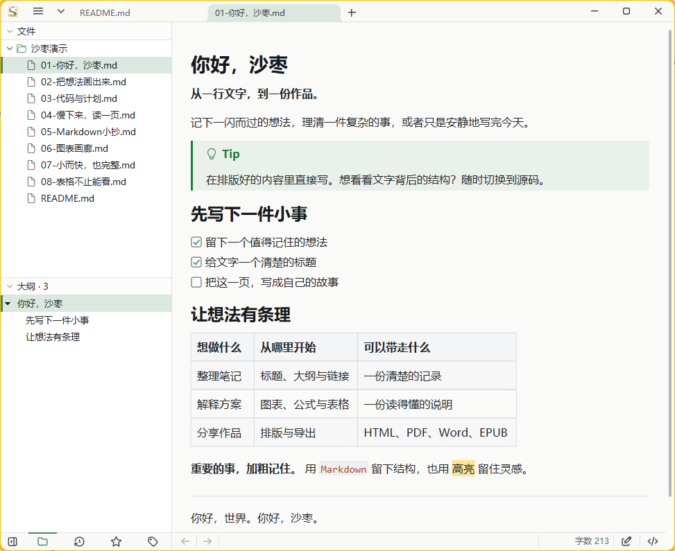
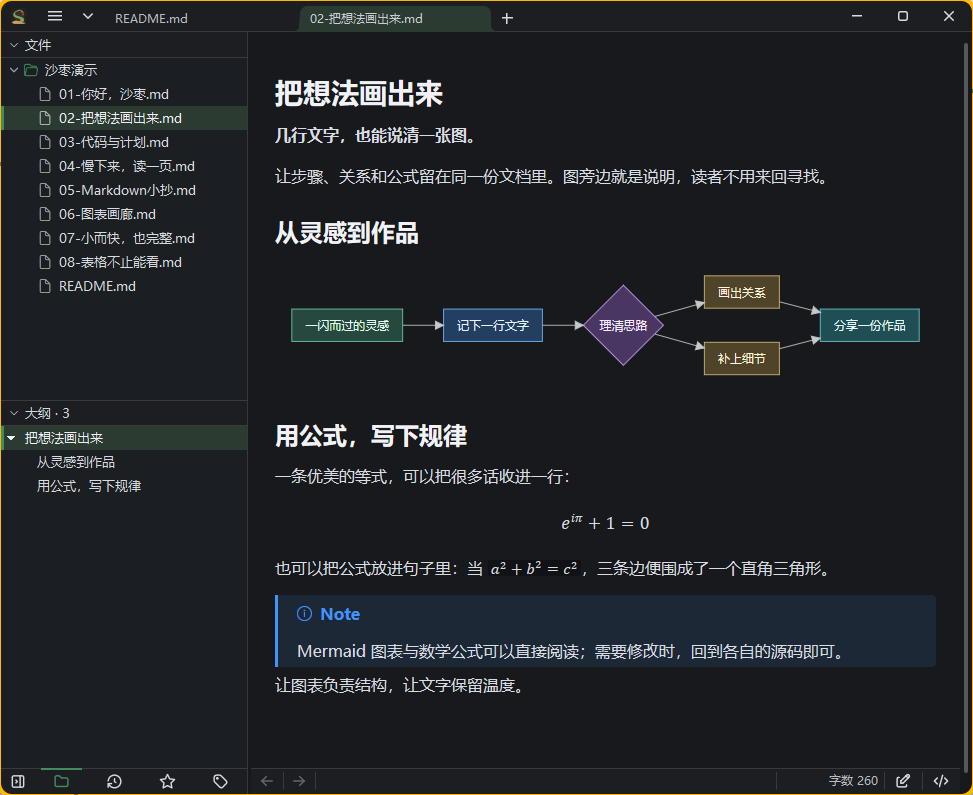
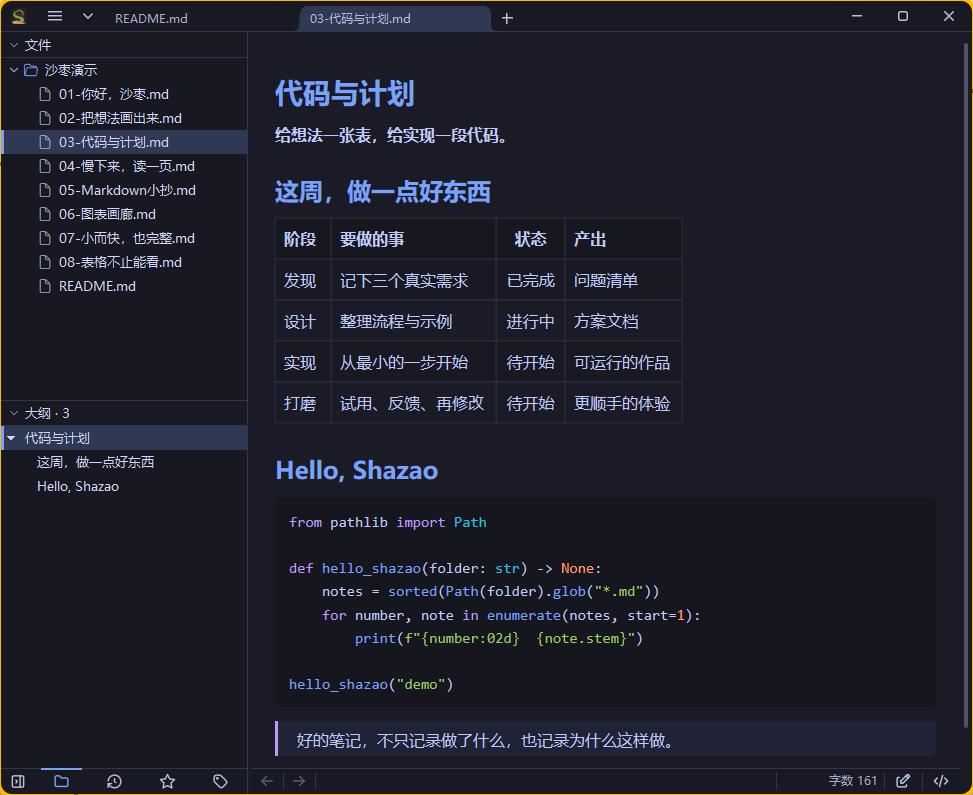
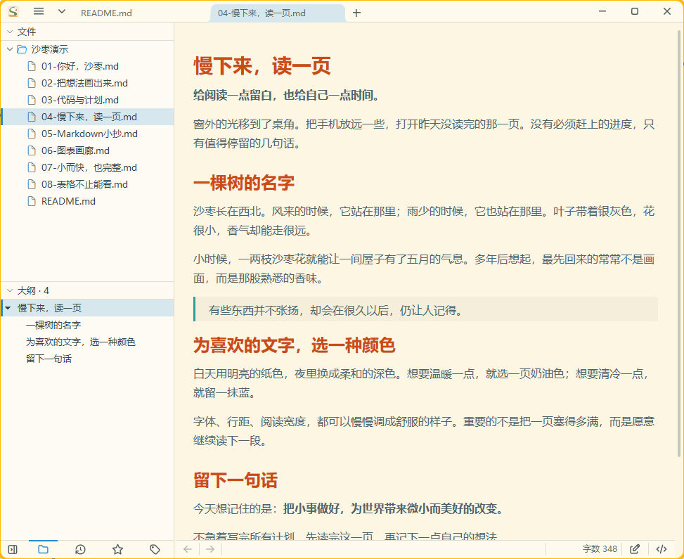
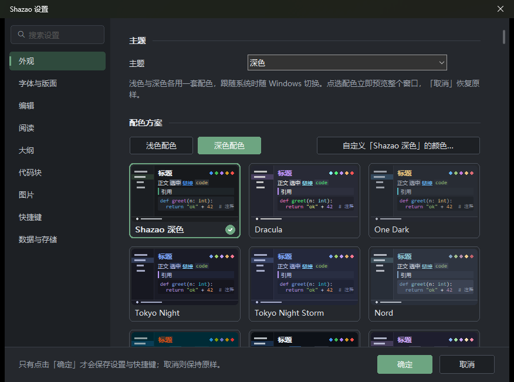

# Shazao（沙枣）

[**简体中文**](README.md) | [English](README.en.md)

**从一行文字，到一份作品。**

Markdown 阅读与编辑器。

**阅读极速秒开 · 所见即所得 · 丰富的图表编辑**。

特点：**单文件、免安装、免账号、免联网、免费**

目前仅支持 Windows ，单个 EXE，无需安装，无浏览器套壳。


注意：

- 暂不开源
- 只有获取网络图片和检查更新软件才会联网。
- Mac 版本在规划中。


## 下载与运行

<a href="https://apps.microsoft.com/detail/9ntw7mf81l2x"></a>

也可以在 Windows 终端运行以下命令，用 WinGet 安装商店版。

```powershell
winget install 9NTW7MF81L2X
```

- [下载最新稳定版](https://github.com/yakoye/Shazao-markdown/releases/latest)：下载 EXE 直接运行，或下载包含版本说明与第三方声明的 win64 ZIP，解压后运行（ZIP 中另有体积约为四成的 UPX 压缩版，功能相同）。支持 Windows 10/11 64 位。
- 历史、草稿、恢复副本、图片缓存、持久撤销和阅读状态默认保存在 `%LOCALAPPDATA%\Shazao`，可在设置的“数据与存储”中管理。INI、快捷键与用户词典保留可编辑入口；旧 `Shazao-history` 等目录兼容读取，升级不直接删除旧数据。
- 想把程序和数据一起放进 U 盘：在 EXE 旁边建一个 `Shazao-data` 文件夹，所有数据就都保存在里面（便携模式）。
- 新版本可在“帮助 ▸ 检查更新…”中下载，下载后按发布的 SHA256SUMS 校验；也可在设置中选择每周检查一次（默认关闭）。
- 各版本的更新内容见[版本历史](doc/CHANGELOG.md)，历史下载见 [GitHub Releases](https://github.com/yakoye/Shazao-markdown/releases)。

## 主要功能

Shazao 在设计上兼顾了轻量化与丰富功能。

- **便携与运行**　单个 EXE 免安装、免账号。可开启离线模式，在 EXE 同级目录创建 `Shazao-data` 即可携带程序和数据。
- **编辑与阅读**　支持所见即所得、源码模式、锁定阅读、专注和打字机模式。可拖拽或复制段落、局部查看源码，并在全文或选区内正则查找替换。
- **大文件处理**　实测 1 GB 文件约 2 秒显示正文。编辑、撤销和保存按改动增量处理，64 MB 以上文件在后台保存。
- **高级渲染**　支持 Mermaid 图表、LaTeX 公式、GFM 与静态 HTML 表格、任务清单、脚注和警告块。支持文字颜色、上下标和代码高亮，Mermaid 图可复制为 SVG。
- **代码与纯文本**　可直接打开常见代码和纯文本文件，支持语法高亮、代码配色、行号、按行列跳转和快捷注释。
- **文档组织**　提供文件树、大纲、标题折叠、收藏、最近打开、文档标签和文件夹搜索。支持侧栏多选、标签页搜索与跨窗口拖拽、Wiki 链接和悬停预览。
- **图片与富文本**　从网页、Word、Excel 粘贴时可转为 Markdown，尽量保留内容结构。图片可查看、缩放、替换、压缩，本地图片文件和 Base64 内嵌图片可互转。
- **导入与导出**　支持 Word 导入，导出 HTML、PDF、Word、EPUB 和含内嵌图片的单个 Markdown 文件。可自定义导出版式并用 CSS 模板批量导出 HTML 或 PDF。PDF 导出需要 Edge 或 Chrome。
- **历史与恢复**　本地历史版本可比较和恢复，支持草稿与异常恢复、持久撤销，并记住每份文档的阅读位置。
- **外观与语言**　可调整主题、字体、行距、每行字数、界面文字大小和快捷键，支持文件夹独立外观。设置可搜索，界面支持简体中文、繁体中文和英语。

## 背景

最近一直在做一个 Windows 下的 Markdown 编辑器，叫 **Shazao（沙枣）**。


这个名字和我的家乡有关。

我来自西北的一座小城，想用一种植物代表那个地方，也代表一种我熟悉的精神，于是选择了**沙枣**。

沙枣是西北很常见的一种植物，耐旱、耐风沙、耐盐碱，也能在贫瘠的土地上生长，生命力很强。


每年五月前后，沙枣花盛开的时候，香气会飘得很远。小时候当地人也会折几枝带回家，插在屋里，整个房间都是沙枣花的味道。

所以我把这个软件取名为 **Shazao**。对我来说，它不只是一个名字，也带着一点对西北、故乡和生活记忆的纪念。

最开始只是想做一个打开 Markdown 文件比较舒服的小工具，后来慢慢加入了编辑、表格、图片、导出、Mermaid、大纲、搜索等功能，现在已经可以作为日常 Markdown 阅读和写作工具使用。

Shazao 是一个 **Windows 原生 Markdown 阅读与编辑器**，使用 C++20、Win32、DirectWrite、Direct2D、WIC 开发，不基于 Electron，也不需要 WebView2，程序保持为单 EXE。

我希望它用起来比较简单：

- 平时直接打开 Markdown 阅读；
- 需要修改时，可以直接在排版后的内容里编辑；
- 需要精确调整 Markdown 时，也可以随时切到源码模式；
- 支持大纲、表格、图片、代码块、任务列表等常见 Markdown 内容；
- 支持 HTML、PDF、Word、EPUB 等多种导出方式；
- Mermaid 图可以直接在编辑器中显示，支持流程图、时序图、状态图、类图、ER 图、甘特图、思维导图、Git 图、C4、时间线、象限图、XY 图等。

从 Word、浏览器、Excel 等程序复制富文本时，Shazao 也会尽量转换成对应的 Markdown，包括标题、格式、链接、列表、表格和图片。

我自己比较在意**打开速度、滚动、输入响应和大文档性能**，所以开发过程中也做了不少自动化、回归和性能测试。

### 软件截图

以下为 `v0.6.20` 的实际界面，使用同一套[演示文档](demo/README.md)拍摄。

**打开就读，落笔就写 · Shazao 浅色**

多标签、大纲、提示块、任务清单与表格，在一页里自然展开。



**把想法画出来 · Shazao 深色**

用 Mermaid 讲清流程，用数学公式写下规律。



**给想法一张表，给实现一段代码 · Tokyo Night**

项目计划与语法高亮留在同一页，点进表格就能继续编辑；深蓝配色让层次更加鲜明。



**为喜欢的文字，选一种颜色 · Solarized Light**

温暖纸色、舒展行距与安静留白，留给愿意慢慢读完的一页。



**还有更多配色，可以慢慢挑。**

| 浅色配色 | 深色配色 |
| :---: | :---: |
|  |  |

## 你好，沙枣

想直接试试看？打开 [`demo/`](demo/README.md)，从[第一份文档](demo/01-你好，沙枣.md)开始。这里准备了阅读写作、图表公式、代码计划、阅读短文和 Markdown 小抄，也可以直接用来录屏与演示。

想进一步了解它为什么小巧又顺手，可以看看[小而快，也完整](demo/07-小而快，也完整.md)，或直接试一试[表格，不止能看](demo/08-表格不止能看.md)。

## 后续开发计划

稳定性与数据安全优先，按反馈逐项开发、验证。以下为后续计划，具体进度与顺序以[开发计划](doc/PUBLIC_ROADMAP.md)为准：

- 窗口分栏：每栏一组标签，标签可在两栏间移动或复制（计划在 v0.7.0）。
- 增加 Ctrl+D 累加选择与同时编辑，完善自动保存控制。
- 继续打磨标签与窗口之间的移动、表格编辑，以及图表文字布局。
- 改进 Wiki 链接的使用体验。
- 完善检查更新与帮助说明，继续校对英文与繁体中文界面。
- 持续推进大图与更多 Mermaid/SVG 特性的兼容，以及输入法、多 DPI 和导出分页的验证。

## 版本历史

最近版本的更新说明与完整历史统一放在[版本历史](doc/CHANGELOG.md)中，README 主要保留软件介绍与使用入口。各版的验证说明与已知问题见对应的[发布说明](https://github.com/yakoye/Shazao-markdown/releases)。

## 反馈

目前项目暂不开源，只发布 Windows 可执行程序。GitHub 主要用于版本说明、软件下载以及问题反馈。

如果使用过程中遇到 Markdown 显示错误、编辑问题、兼容性问题，或者有什么功能建议，欢迎通过 [GitHub Issues](https://github.com/yakoye/Shazao-markdown/issues) 或[小众软件论坛](https://meta.appinn.net/t/topic/93080)反馈。

**欢迎给我挑毛病，反馈各种问题，提出你的需求。**

## 大家怎么说

> “这么小的体积真的无敌了”  —— [flintt](https://meta.appinn.net/t/topic/93080/92)

> “沙枣真是越用越顺手”  —— [kat](https://meta.appinn.net/t/topic/93080/64)

> “我要求不高,所以能替换Typora了”  —— [914066828](https://meta.appinn.net/t/topic/93080/2)

> “雀食很简洁”  —— [patpat](https://meta.appinn.net/t/topic/93080/13)

> “牛啊，这么小，早知道自己不折腾markdown编辑器了”  —— [flintt](https://meta.appinn.net/t/topic/93080/21)

> “好用，爱用”  —— [Time](https://meta.appinn.net/t/topic/93080/23)

> “卧槽，好久没见到过这么精品的了。打开速度极快，而且非常轻量”  —— [xmmdg](https://meta.appinn.net/t/topic/93080/31)

> “很快，更新快、启动快，替换掉tinta、typora及其它md阅读、编辑器了”  —— [foolsic](https://meta.appinn.net/t/topic/93080/32)

> “Shazao强大、简明、小巧、易用性好，正从其它平台上迁移过来”  —— [david9310](https://meta.appinn.net/t/topic/93080/33)

> “确实够快!!! 简单使用直接替代typora”  —— [leeyaunlong](https://meta.appinn.net/t/topic/93080/34)

> “好用！！使用轻快，功能全面，目前在我的使用场景已经替代Typora了”  —— [YUIoTer](https://meta.appinn.net/t/topic/93080/37)

> “真的很棒，在此之前我一直用 sublime text 编辑 md 文档，哪怕 vscode 之类的功能更强也没打动我，我看中的是资源消耗和响应速度。最初发布的时候好像不支持多件和标签，我试过之后就放弃了，但这次再试就已经满足我的要求了”  —— [jxcangel](https://meta.appinn.net/t/topic/93080/53)

> “建议微软收编此项目，将记事本从历史上抹去”  —— [patpat](https://meta.appinn.net/t/topic/93080/57)

谢谢大家愿意把沙枣带进日常，也愿意指出那些还不够顺手的地方。具体的使用反馈，会继续推动它一点点变好。

## Star 历史

如果沙枣帮到了你，欢迎在 [GitHub](https://github.com/yakoye/Shazao-markdown) 点一颗 Star。

[](https://www.star-history.com/#yakoye/Shazao-markdown&Date)

## 文档与说明

[版本历史](doc/CHANGELOG.md) · [开发计划](doc/PUBLIC_ROADMAP.md) · [演示文档](demo/README.md) · [文档索引](doc/PUBLIC_DOCS.md)

版本更新详情集中保存在 changelog，候选版与正式版分别说明；每版已验收范围与已知问题见对应的发布说明。

## 感谢支持

感谢每一位愿意支持沙枣的人。一次赞助、一条建议，或一句“用着顺手”，都是继续打磨它的动力。

| 赞助者 | 留言 |
| :--- | :--- |
| \*喂 | 好久没见纯cpp的md阅读器了，完成度很高 |
| \*员 | 沙枣用户，加油 |

姓名按收款记录中的脱敏形式展示，不列金额。

感谢kat*明、帮我设计logo，感谢小众所有网友提的意见和建议。
